# User guide: accounts and sign-in

Dominion Helper is invite-only. The first person to run the app creates the administrator account with a setup token; everyone else joins through an invite link from the administrator.

Screenshots were captured from a local stack in Chromium at 900 px (desktop) and 390 px (phone) widths. They may drift as the interface changes.

## Home page

When you are signed out, the home page shows a **Log in** link and a status line confirming the database and simulation service are reachable.

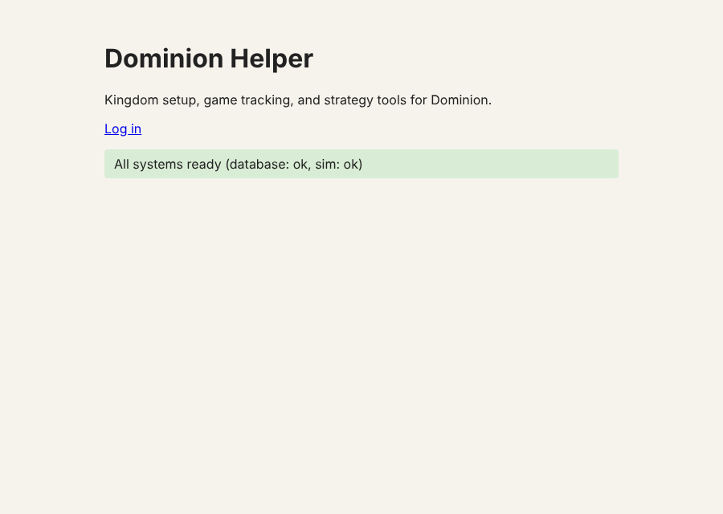

Once signed in, the page shows who you are (admins also get an **(admin)** link).

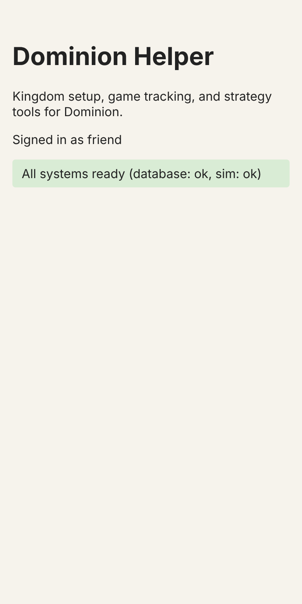

## First-run setup (administrator)

1. Set `SETUP_TOKEN` in `.env` to a secret of at least 16 characters (for example `openssl rand -base64 24`) and start the stack.
2. Open `/setup.html`. While no account exists, `/login.html` redirects here.
3. Enter the setup token, then choose a username (3-32 letters, numbers, `_` or `-`) and a password (12-128 characters).

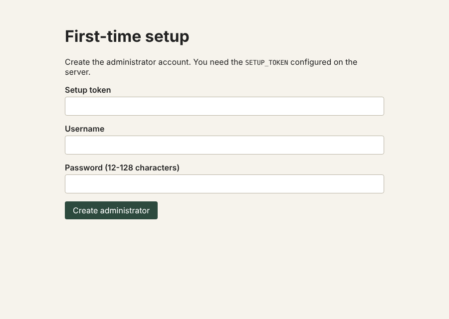

A wrong setup token is refused and no account is created.

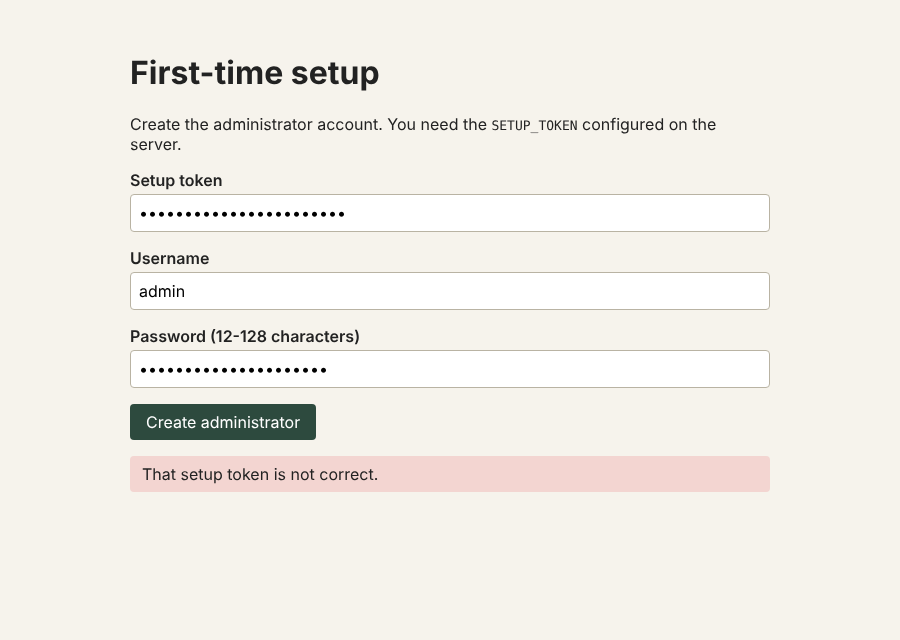

Setup works only once: as soon as any account exists, the setup endpoint stops responding.

## Inviting a friend (administrator)

After setup you land on the administration page (`/admin.html`).

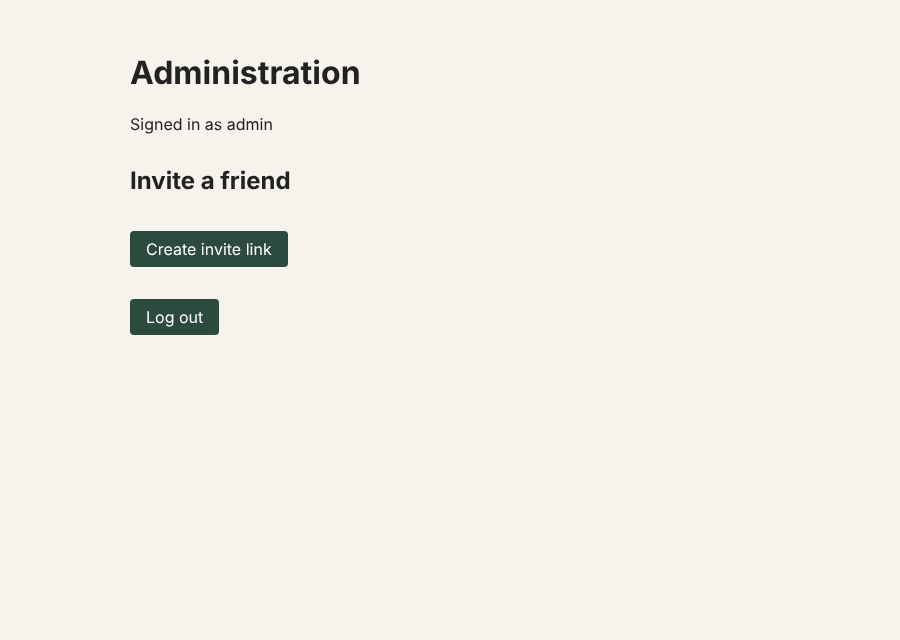

Choose **Create invite link** and send the link to your friend. Each link works once and expires after 72 hours. The token sits after the `#` in the address, so it is not sent to the server when the page loads.

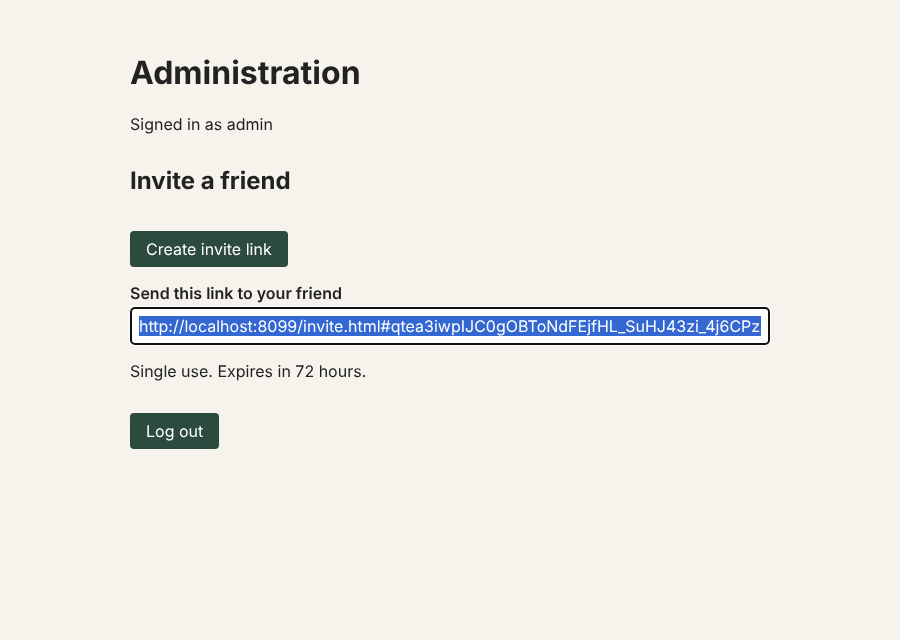

## Accepting an invite

Your friend opens the link, picks a username and password, and is signed in straight away.

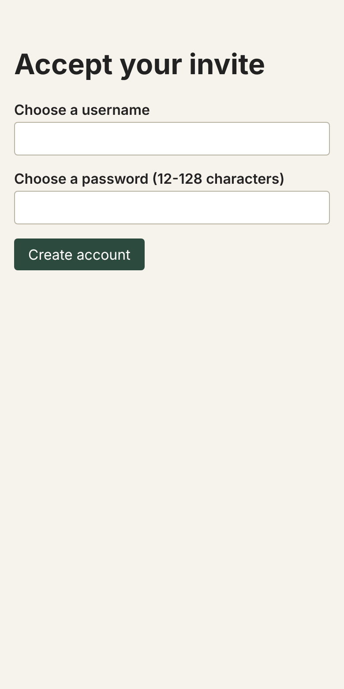

If the link was already used, has expired, or is incomplete, the page says so and no account is created.

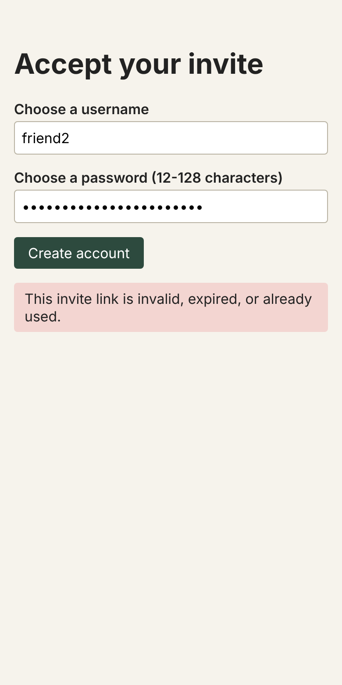

## Logging in

Use `/login.html` on later visits.

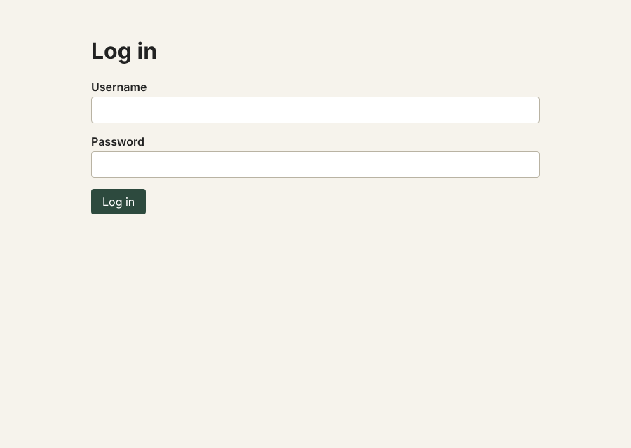

A wrong username or a wrong password gives the same message, so the page does not reveal which usernames exist.

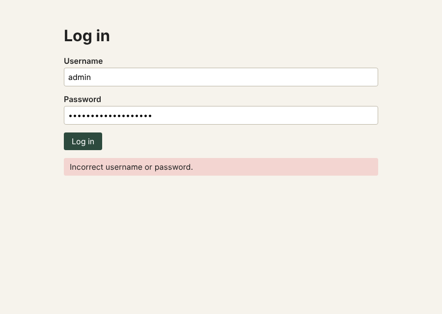

## Browsing cards

Choose **Browse cards** on the home page (`/cards.html`). The list covers 852 cards from 24 editions, from the 2008 base game to Rising Sun. Each entry shows the cost, the card's types and the editions it appears in. Cards that cannot be part of a kingdom, such as Events and Landmarks, say so.

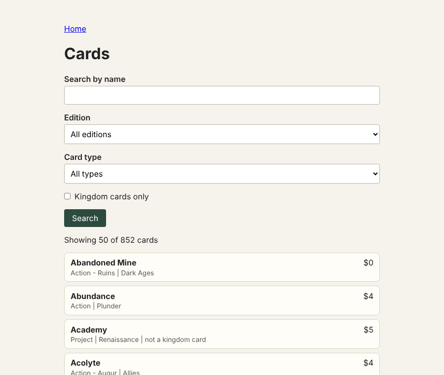

Search by English or German name, filter by edition or type, or tick **Kingdom cards only**. Results load 50 at a time; choose **Show more** for the rest.

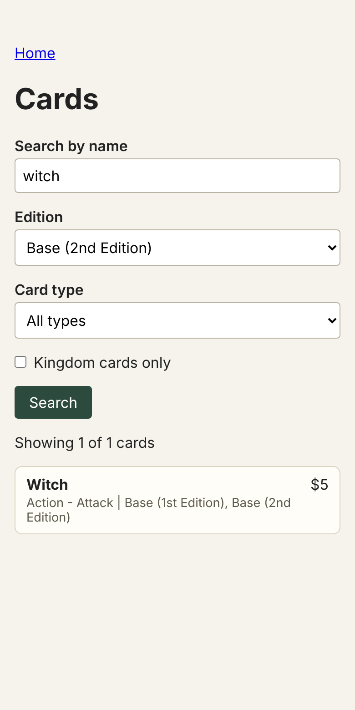

Each card has a **Show picture** button. It loads the picture from your own cards folder (see "Card pictures" in the README for the file names) and **Hide picture** removes it again. If a card has no picture file yet, the page tells you which file name to add. The pictures are not included with the project.

The browser shows names, costs, types, editions and pictures only. Card text and rulings are not included yet.

## Playing a game

Choose **Games** on the home page, then **Start a new game**. A game belongs to the account that started it, and other accounts cannot see it.

### Starting a game

Choose 2, 3 or 4 players and type their names. Then choose ten kingdom cards: press **Random 10** (optionally limited to one edition), or search for a card by name and press **Add**. Look over the ten cards before you start, and use **Remove** to swap any out. Tick **Use Platinum and Colony piles** if you want them.

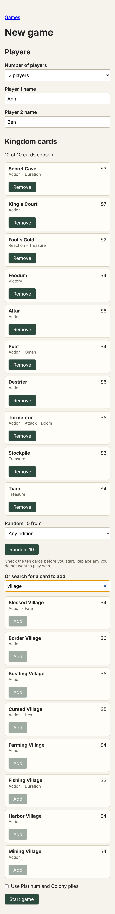

Random 10 only draws cards that are an ordinary pile of their own. It skips Events, Landmarks, Projects and other cards that are not in the supply, plus Knights, Castles, Ruins, Looters and split piles. You can still add those by searching, and the tracker handles them as described under "What is not enforced".

### During the game

The top of the screen shows whose turn it is. The three counters track Actions, Buys and Coins for the current turn and reset when you press **End turn**. Under **Scores**, the buttons add or remove victory points for each player. **Take** and **Return** move cards in and out of a supply pile, and the pile list shows how many are left.

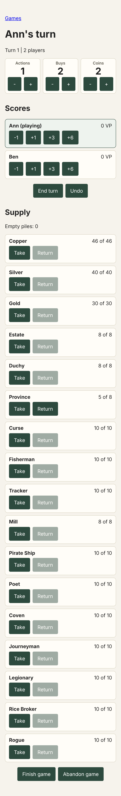

Starting pile sizes follow the player count: Copper is 60 minus 7 per player; Silver 40; Gold 30; Estates, Duchies and Provinces 8 each with 2 players and 12 each with 3 or 4; Curses 10, 20 or 30; every kingdom pile 10, except Victory-type cards at 8 or 12. Potions (16) are added when a card costs a potion. Platinum (12) and Colony (8 or 12) are added when you tick the box.

The game ends at the end of the turn in which the Province pile is empty, the Colony pile is empty (when used), or any three piles are empty. When one of those happens, a banner says so, and **End turn** finishes the game.

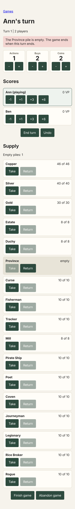

### Result

The player with the most victory points wins. If points are tied, the player who has taken fewer turns wins, and if turns are also equal the win is shared.

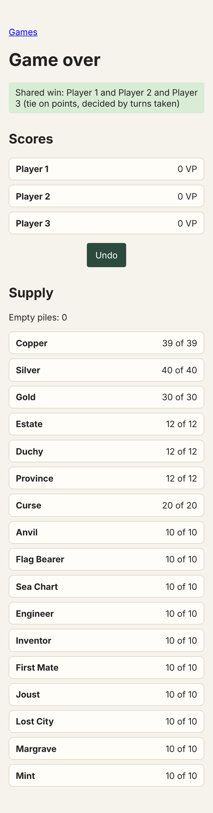

Victory points are entered by hand, so the result is only as accurate as the scores you enter. **Undo** steps back one change at a time, even after the game has ended. **Finish game** ends a game early and **Abandon game** closes it without a result. Your games are listed under **Games**, where you can resume any game in progress.

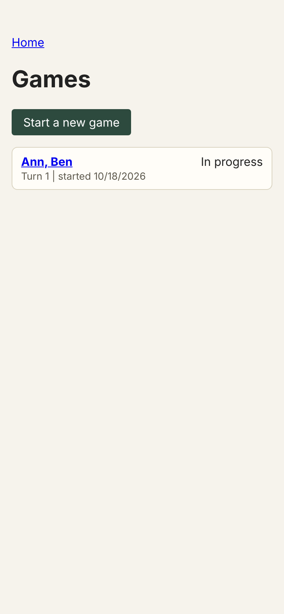

### What is not enforced

- Knights, Castles, Ruins, Travellers, split piles such as Encampment and Plunder, and the Allies piles are counted by hand: the tracker shows the pile with a number box you set yourself. The reason is that the card data does not say how these piles are built, and their sizes have not been confirmed. The groupings are in `db/data/supply-rules.json`.
- Looters need a Ruins pile, which the tracker does not add; it shows a reminder to track it yourself.
- Events, Landmarks, Projects, Ways, Traits, Prophecies, Allies and other non-supply cards cannot be chosen as kingdom piles yet.
- Card effects are not applied. The tracker counts piles and points; you move coins and actions yourself.

## Good to know

- Sessions last 30 days and renew while you keep using the app. **Log out** on the administration page ends the session on that device.
- After 8 failed attempts a username is locked for 15 minutes.
- Session cookies are marked `Secure` by default, which needs HTTPS (or `http://localhost`). If you serve plain HTTP on a LAN address, set `COOKIE_SECURE=false` in `.env`.
- There is no password reset yet. A forgotten password currently needs a new invite.
